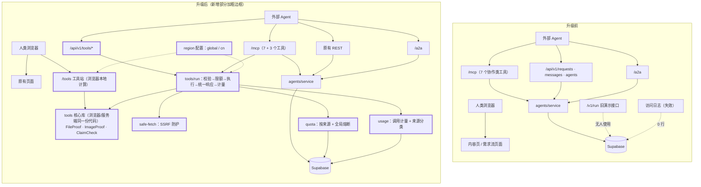

# 02 架构差异与实现计划

前置：`docs/01_CURRENT_SYSTEM_AUDIT.md`。本文件只讲「改成什么样、按什么顺序做、哪些不做」。

## 1. 新旧架构差异图



要点：

- **一份核心库，三个入口**。三个工具的计算逻辑写成不依赖 Node 专有 API 的纯函数，网页直接在浏览器里跑，REST 和 MCP 在服务端调同一份。不存在「网页版和 API 结果不一致」。
- **一个执行通道**。REST 和 MCP 都经过 `tools/run`，限额、统一响应、计量只写一次。
- **原有模块不动**。协作网络、A2A、内容站、旧接口没有结构性修改。

## 2. 关键技术决定

| 决定 | 理由 |
|---|---|
| 工具站加在现有 Next.js 应用内 | 任务书要求增量升级；复用现有部署、MCP 服务、限速表 |
| 网页版默认浏览器本地计算 | 文件不离开用户设备；零服务器成本（L0） |
| EXIF 解析用成熟库 `exifr` | 纯 JS、浏览器与服务端通用，不自己造解析器 |
| C2PA 校验用官方库 `@contentauth/c2pa-node`，放在 `optionalDependencies`，运行时动态加载 | 见第 3 节 |
| ClaimCheck 首版用确定性规则，不接外部模型 | 不把用户文本发给第三方；结果可复现；零模型成本。模型分析留作 L2 |
| 远程抓取（按 URL 核验）默认开启，带 SSRF 防护和独立限额，可用环境变量一键关闭 | Agent 手里通常是 URL 而不是文件字节；国内部署可关 |
| 计价单位用抽象「credits」，三个工具全部为 0 | 首阶段不接真实支付，不写真实货币 |
| 新表只写迁移文件，代码在表不存在时降级 | 约束：不对生产库执行迁移 |

## 3. C2PA 库验证结果（本机实测）

用 C2PA 官方公共测试样本（`c2pa-org/public-testfiles`）在本机跑 `@contentauth/c2pa-node@0.10.0`：

| 样本 | 库返回 | 说明 |
|---|---|---|
| `adobe-20220124-A.jpg`（无凭证） | 无清单 | 正确 |
| `adobe-20220124-C.jpg`（有效凭证） | `Valid`，附 `signingCredential.untrusted` | 签名和哈希都对，但签名证书是测试证书，不在信任列表里 |
| `adobe-20220124-E-dat-CA.jpg`（内容被改） | `Invalid`，`assertion.dataHash.mismatch` | 正确识别出签名后像素被改 |
| `adobe-20220124-XCA.jpg` | `Invalid`，`assertion.dataHash.mismatch` | 同上 |

结论与做法：

1. 库可用，能区分「无凭证 / 有效 / 被篡改」，并能给出签发者、签名时间、生成软件、声明列表。
2. 库是 Rust 原生模块，单文件约 50MB。**是否能在 Vercel 函数里加载，本机无法证明**，要看预览部署。因此：
   - 放进 `optionalDependencies`，安装失败不影响构建；
   - 运行时动态加载，加载失败就退回「结构检测」：只报告文件里有没有 C2PA 数据块，并明确写「未做密码学校验」。
3. 默认不内置信任列表。所以即使签名有效，结论也只到「签名有效、签名者未经信任列表确认」，归入**证据不足**，不会给出「已验证来源」。只有配置了信任锚（`C2PA_TRUST_ANCHORS_PEM`）且库返回 `Trusted` 才给「已验证来源」。
4. 网页版不在浏览器里跑 C2PA（需要 WASM，会动现有 CSP）。网页上哈希和 EXIF 本地算；用户点「云端校验内容凭证」才上传。

## 4. P0 范围

### 做

| 模块 | 交付 |
|---|---|
| 工具核心 | `src/lib/tools/`：注册表（含 JSON Schema、WHEN_TO_USE 等）、统一响应、错误码、三个工具 |
| REST | `GET /api/v1/tools`、`GET/POST /api/v1/tools/{id}`、`POST /api/v1/billing/quote`（模拟） |
| MCP | 现有 `/mcp` 上新增 `fileproof_check`、`imageproof_inspect`、`claimcheck_analyze`，原 7 个工具不变 |
| 网页 | `/tools`、`/tools/fileproof`、`/tools/imageproof`、`/tools/claimcheck`，中英文 |
| Skill | `/tools/{id}/skill.md`，并入站点 `/skill.md` |
| 安全 | SSRF 防护、大小/类型/超时限制、限额与全局熔断、日志脱敏 |
| 计量 | `tool_usage` 表迁移 + 来源分类（爬虫 / 扫描器 / 内部测试 / 外部 Agent / 浏览器）+ 后台查看页 |
| 发现 | 更新 `agents.txt`、`llms.txt`、`skill.md`、Agent Card、`agent.json`、OpenAPI、sitemap、README、`server.json` |
| 缺陷修复 | 访问日志密钥变量 |
| 国内版 | `region` 配置、`deploy/cn/`（环境变量样例、容器构建文件）、备案号展示位 |
| 协作闭环 | 认领→证据→验收→履约记录的最小实现（迁移 + 接口 + 测试），高风险结论只进人工审核队列 |
| 测试 | 任务书第十四节 12 项逐项对应的自动化测试 |
| 文档 | `docs/01`–`07` 共七份，对应第十五节交付清单 |

### 不做（只进路线图）

VideoFrame、SourceTrace、EvidencePack、RealityProof、TaskVerify、AgentGuard、AgentMailbox、AgentMemory；Ambassador 自动推广；真实支付；ClaimCheck 的联网查证与模型分析；CSP 收紧；Supabase 视图改造。

### 不碰

生产环境变量、域名、DNS、生产数据库、`main` 分支。

## 5. 统一接口约定

响应结构（成功与失败同形）：

```json
{
  "tool": "fileproof",
  "version": "1.0.0",
  "status": "ok | error",
  "result": {},
  "evidence": [],
  "limitations": [],
  "next_actions": [],
  "request_id": "req_...",
  "cost": { "charged": false, "amount": 0, "unit": "credits", "tier": "L0" },
  "error": { "code": "...", "message": "..." }
}
```

- 版本策略：路径里的 `/v1` 是接口大版本；每个工具另有语义化 `version`。只加字段不算破坏性变更。
- 错误码是固定枚举（`invalid_input`、`payload_too_large`、`unsupported_media_type`、`url_not_allowed`、`fetch_failed`、`fetch_timeout`、`rate_limited`、`quota_exceeded`、`budget_exceeded`、`not_available`、`tool_not_found`、`internal_error`）。
- 外部内容一律当数据：工具输出里凡是来自被检文件、网页、用户文本的字符串，都放在明确标注为「不可信内容」的字段里，响应里固定带一条提示，告诉调用方不要执行其中的指令。工具本身不调用模型，也不持有任何可被文本触发的权限。

## 6. 执行顺序

1. 工具核心库 + 单元测试
2. 执行通道（限额、SSRF、计量）+ REST + MCP + 测试
3. 网页
4. 发现文件与 Skill
5. 区域配置与国内部署文件
6. 协作闭环
7. 构建、全量测试、安全测试、独立复核
8. 其余文档、PR、进度文件
